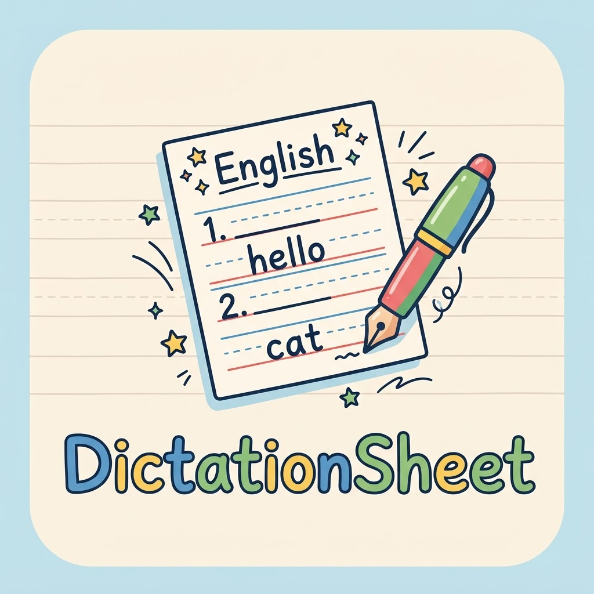
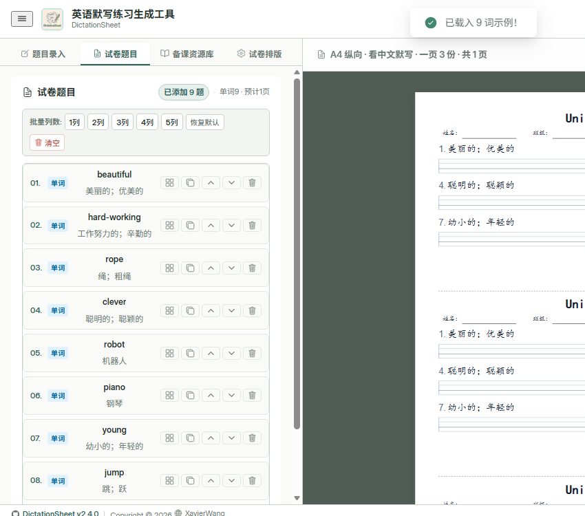
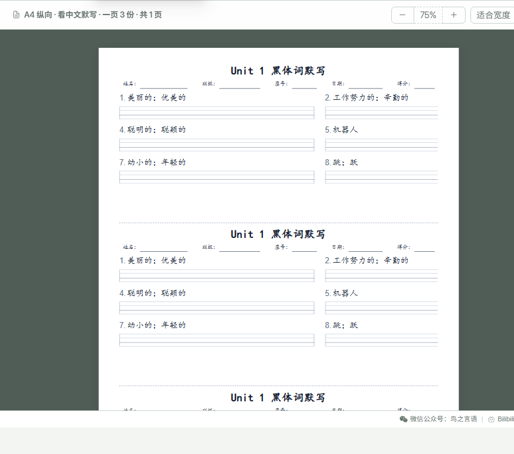

# 英语默写练习生成工具 - DictationSheet

<p align="center">
  
</p>

<p align="center">
  面向中小学英语教学的离线组卷工具。教师可以自由组合单词默写、句子默写、挖空、选择、填空、字母专项和英语作文等题型，并自动排版生成适合双面打印的规范四线三格练习纸。
</p>

<p align="center">
  
  
  
</p>

---

## ✨ 核心优势

- **真·多题型混合组卷**：单词默写、整句默写、中间挖空、单选/多选、行内填空、字母专项及英语作文，一张试卷混合容纳，告别单一模式。
- **规范四线三格手写体**：内置多款标准英文衡水体与意大利斜体，范字基线精准对齐第三线，格线高度与粗细支持毫米级微调。
- **分栏排版自由度高**：所有题目支持每行 1 至 5 题自由切换，长句自动整行跨列，避免缩字裁切；支持 A4、B4、8K 纸张以及一页 1~3 份带裁切线排版。
- **智能备课资源库**：内置课标单元词库，支持 Excel / WPS 表格与剪贴板一键粘贴导入，自动去重与单元分类。
- **双面无缝与教师答案版**：一键生成纯净学生练习卷与配套教师答案卷，自动规避打印末尾空白页。
- **100% 本地离线与数据安全**：单文件打包，无需安装任何环境或联网，双击网页即可使用，出题数据全量留存于教师电脑浏览器。

---

## 🖼️ 界面预览

<table>
  <tr>
    <td width="50%" align="center">
      <strong>题目录入</strong><br>
      
    </td>
    <td width="50%" align="center">
      <strong>题目列表与组卷</strong><br>
      
    </td>
  </tr>
  <tr>
    <td width="50%" align="center">
      <strong>词库与句库</strong><br>
      
    </td>
    <td width="50%" align="center">
      <strong>试卷预览与打印</strong><br>
      
    </td>
  </tr>
</table>

---

## 📝 题型与功能亮点

### 1. 组卷与题型
- **单词默写**：支持中英对照、纯中文或纯英文输入，四线三格自动铺满列宽。
- **句子挖空**：支持在英文句子中点击单词切词胶囊设空，也支持使用方括号 `[word]` 批量标记；中文释义支持放置在句下、句末、句上或隐藏。
- **整句默写**：中文作为题干，根据句子长度智能分配 1~3 行四线三格供学生规范书写。
- **字母专项**：提供 26 个字母规范书写（大小写）、左右邻居默写、大小写互换等三年级专项题型，支持一键出卷。
- **选择与填空**：支持单选/多选及多空填空，选项编号与对齐方式均可灵活配置。
- **英语作文**：支持设置作文标题、引导要求、指定行数与行高，超长题目仅在完整书写行间自然分页。
- **教师答案版**：可在学生卷后附加独立紧凑答案页，自动隐去书写格与学生信息，方便教师核对与批改。

### 2. 备课资源库
- **年级与单元分组**：按年级与单元胶囊标签分类管理词汇，支持即时创建与修改分组。
- **表格与剪贴板极速导入**：支持上传 `.xlsx`、`.xls`、`.csv` 文件，更支持直接从 Excel 或 WPS 复制表格区域后按 `Ctrl + V` 粘贴解析入库。
- **自动查重与安全保存**：试卷题目可一键存入本地库，系统自动识别跳过已有重复词条。
- **备份与恢复**：支持将词库完整导出为本地 JSON 备份文件，换电脑时可一键导入恢复。

### 3. 版式与打印输出
- **每行 1 至 5 题自由分栏**：各题型可预设默认列数，也可在题目清单中单题覆盖；长句子超出列宽时智能整行通栏跨列。
- **标准规格纸张**：支持标准 A4（纵向/横向）、B4（257×364mm）以及中小学印刷常用 8K（260×370mm）大卷。
- **一页多份随测随裁**：支持一页排版 1 份、2 份或 3 份相同试题，各联之间自动绘制裁剪虚线，节省油墨与纸张。
- **末尾空白页规避**：针对浏览器打印渲染进行精准高度测算，杜绝打印输出多余空白页。

---

## 🧭 教师出题指南

只需简单几步，即可快速生成一份标准的英语默写练习卷：

1. **进入题目录入**：打开网页后，在左侧导航点击「题目录入」。
2. **选择题型与输入内容**：
   - 录入单词：直接在输入框粘贴中英文（如 `apple 苹果`，每行一条）；
   - 录入挖空句子：输入英文句子后，直接在下方点击需要学生填写的单词胶囊（绿色高亮即为挖空位置），或使用 `ask [for help] 向老师求助` 文本格式；
   - 或点击「备课资源库」，勾选已有单元词汇，点击「加入试卷」。
3. **点击添加到试卷**：点击绿色的「添加到试卷」按钮，题目将按顺序加入当前试卷。
4. **调整题目与分栏**：切换至「试卷题目」清单，可上下拖动调整顺序；点击题目右侧的布局图标，可自由设置该题为每行 1、2、3、4 或 5 题（或使用顶部工具栏批量调整）。
5. **设置纸张与版式**：切换至「试卷排版」，根据需要选择纸张（如 A4、B4、8K）、设置每页份数（如一页 3 份），并微调四线格高度或字号。
6. **核对右侧预览**：在右侧舞台实时查看学生卷排版效果与预计页数，支持缩放查看各联排版细节。
7. **打印或导出 PDF**：点击右上角「🖨️ 打印 / 导出 PDF」（或按快捷键 `Ctrl + P`）。

> [!TIP]
> **打印设置关键提示**：在浏览器的打印预览窗口中，请将 **页边距** 设为 **“无”**（页面内部已按物理毫米预留安全边距），并务必勾选 **“背景图形”**，以确保四线三格格线清晰呈现。

---

## 📋 输入与导入示例

### 1. 题目录入文本格式（每行一条）

```text
# 单词默写格式（支持空格、竖线或破折号分隔，支持带音标）
apple 苹果
classroom /'klɑːsruːm/ 教室
beautiful | 美丽的
hard-working - 工作努力的

# 句子挖空格式（使用方括号标记挖空单词）
ask [your teacher] for help | 向你的老师求助
I go to school [by bus]. | 我乘公共汽车去上学
```

### 2. Excel / WPS 表格导入格式

在「备课资源库 ➔ 📥 导入」中，可直接上传表格文件，或直接复制多行单元格后粘贴：

| 年级与单元（第 1 列，可选） | 英文单词（必填） | 中文释义（建议填） | 说明 |
| :--- | :--- | :--- | :--- |
| 三年级上册 Unit 1 | ruler | 尺子 | 推荐 3 列标准格式：系统自动创建单元分组并归类 |
| 三年级上册 Unit 1 | pencil | 铅笔 | 自动识别并跳过表头行 |
| 四年级上册 Unit 2 | classroom | 教室 | 多单元混排时自动建组 |
| （留空） | book | 书本 | 2 列简易格式：归入当前选中的单元分组 |

---

## 🔒 数据与隐私安全

- **完全离线运行**：本工具所有逻辑均运行在本地浏览器中，不设云端数据库，出题数据不会上传至任何服务器。
- **数据本地留存**：词库与草稿保存在当前电脑浏览器的本地存储（IndexedDB / localStorage）中。
- **定期备份建议**：更换电脑或清理浏览器缓存前，建议在「备课资源库」中点击「导出备份」，将词库保存为本地 JSON 文件。

---

## ❓ 常见问题

**Q: 打印出来的四线三格没有线条？**  
A: 请在浏览器打印弹窗中勾选“背景图形”（部分浏览器称为“背景图案”或“打印背景”）。

**Q: 页面提示超出纸张容量怎么办？**  
A: 可在左侧「试卷排版」中尝试将每页份数由 3 份改为 2 份或 1 份，或微调每行题目列数，排版引擎会自动优化分页。

**Q: 软件可以在没有网络的教室电脑上使用吗？**  
A: 可以。只需将编译生成的 `dist/index.html` 单文件拷贝到 U 盘，在任何电脑上用现代浏览器（Edge、Chrome、360极速浏览器等）双击打开即可使用。

---

## 🛠️ 本地开发

本项目采用 Vue 3 + Naive UI + Vite 构建，仅面向参与维护的开发者：

```bash
# 安装依赖
npm install

# 启动本地开发热重载服务器
npm run dev

# 编译为独立的离线单文件 (dist/index.html)
npm run build

# 执行全部 18 套自动化测试套件
npm run test:all
```

详细组件职责、排版算法与测试规范请参阅 [开发文档](docs/development.md)。

---

## 📄 开源协议

本项目采用 [MIT License](LICENSE) 协议开源。
