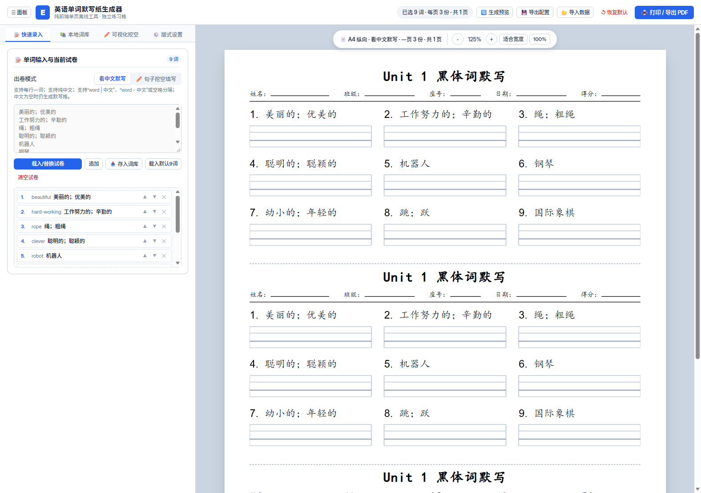
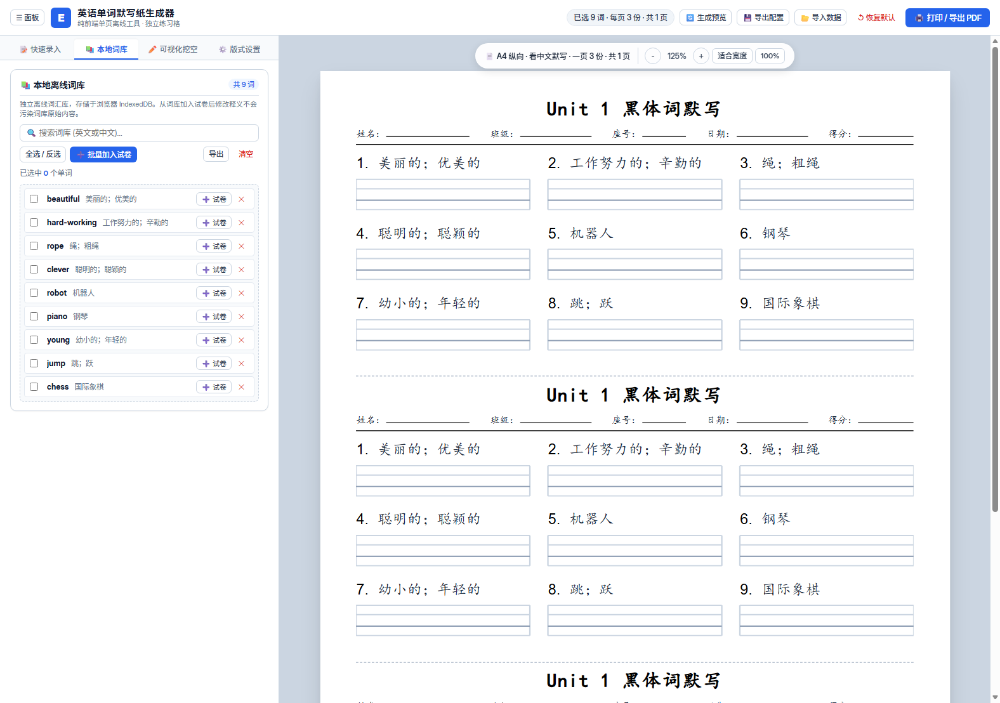
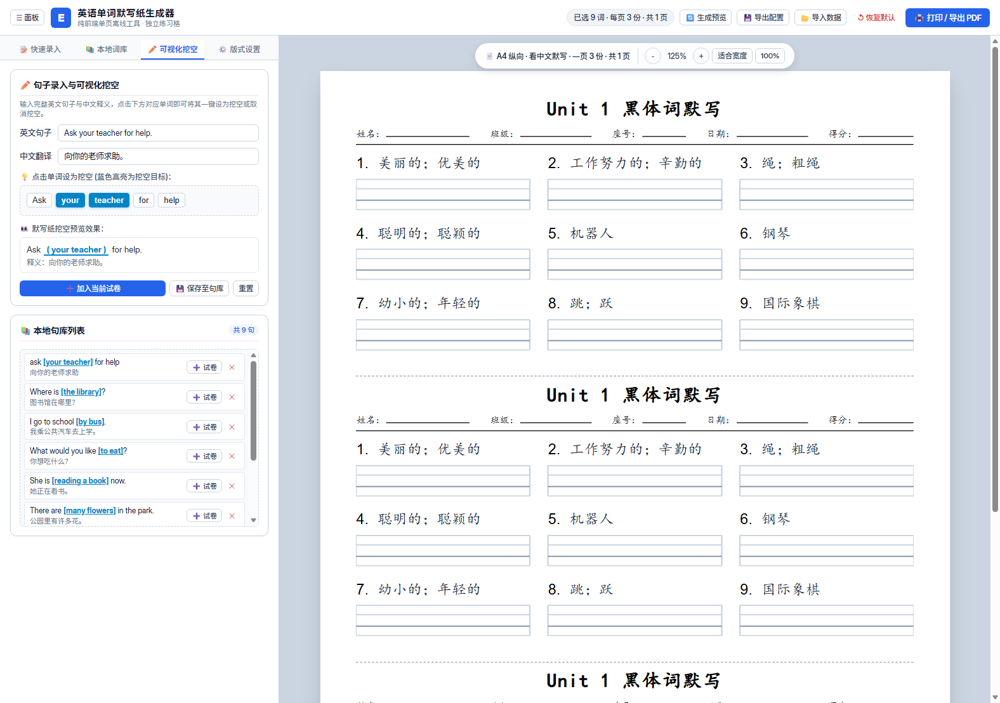
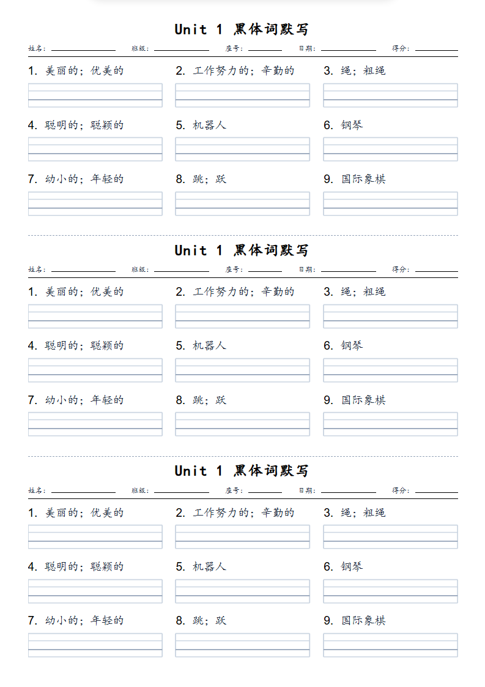

# DictationSheetGen - 英语单词与句子默写纸生成器

一款专为中小学英语教学设计的排版工具。采用纯前端单文件架构，无需安装依赖，无需配置环境，双击网页即可离线使用。

支持看中文默写、句子挖空填写两种出卷模式，提供规范四线三格矢量排版，支持 A4、B4、8K 纸张以及一页多份自动裁切虚线。

---

## 界面预览

### 快速录入与看中文默写


### 本地离线词库（搜索与批量加入）


### 句子可视化选词挖空


### 排版成品效果（一页 3 份）


---

## 功能特性

### 1. 结构化四工作区导航
- **清晰职责划分**：顶部提供 **📝 快速录入**、**📚 本地词库**、**✏️ 可视化挖空**、**⚙️ 版式设置** 四大工作区。
- **避免臃肿**：快速粘贴输入与持久化词库管理解耦，设置项按需配置，操作流线清晰直观。

### 2. 本地离线词库与智能查重
- **IndexedDB 独立存储**：支持保存海量词汇与句子，数据存储于本地浏览器，无网络传输。
- **按年级/单元智能分组管理**：支持将单词归入各年级/单元（如 `三年级上册 Unit 1`、`四年级上册 Unit 1`、`五年级上册 Unit 1`），顶部提供横向胶囊标签快速过滤、一键批量修改/移动分组，支持随时创建任意自定义单元。
- **支持 Excel / CSV 表格与剪贴板极速导入**：
  - 原生支持 `.xlsx`、`.xls`、`.csv` 文件直接上传导入；
  - 完美识别 3 列格式 `[年级与单元] [英文单词] [中文释义]`，导入时自动建立单元并按每行单元分别归类；
  - 完美识别 2 列格式 `[英文单词] [中文释义]`，支持批量归入指定或新建的单元分组；
  - 支持从 Excel 或 WPS 复制单元格后直接按 `Ctrl + V` 粘贴解析，免存文件，即粘即用；
  - 界面提供标准 Excel (`.xlsx`) 与通用 CSV (`.csv`) 模板一键下载。
- **内置人教 PEP 经典课标单元词库**：预设三年级（文具）、四年级（教室设施）、五年级（人物特征）等经典单元词汇表，支持一键载入词库。
- **双向独立安全**：从词库加入试卷后，在试卷中修改释义不会污染词库原始条目。
- **毫秒级检索与批量操作**：支持按英汉关键词及单元分组实时搜索过滤，支持单条插入、单条删除、全选与一键批量加入试卷。
- **自动查重保护**：支持将试卷草稿反向保存至词库，自动识别重复词条并跳过，保存时自动提取试卷标题作为默认单元分组。

### 3. 句子交互式可视化挖空
- **免括号输入**：输入完整英文句子与中文翻译后，自动分词生成可点击的药丸胶囊。
- **点击即挖空**：鼠标点击任意单词即可将其设为挖空目标（高亮蓝色显示），支持连续多词合并挖空。
- **实时效果预览**：在输入区即时呈现下划线挖空效果，确认后一键加入试卷或存入句库。

### 4. 纸张与多联排版
- **多纸张规格**：支持标准 **A4**（210×297mm，纵向/横向）、**B4**（257×364mm）及学校常用大卷 **8K**（260×370mm）。
- **一页多份**：支持一页排版 1 份、2 份或 3 份相同练习（默认 3 份），试卷之间自动绘制标准裁切虚线，便于教师裁切分发。
- **自定义边距**：支持 4~16mm 页边距实时调整。

### 5. 三出卷模式与规范四线三格
- **看中文默写**：题号 + 中文释义位于上方，下方为独立手写练习格。
- **句子挖空填写**：
  - 支持句中内嵌四线三格填空（推荐，版式紧凑，避免下方重复出现大格子）；
  - 支持句下独立书写格；
  - 标点符号与四线格紧凑对齐，中文括号整词换行。
- **三年级英文字母专项默写**：
  - **26 个字母规范书写**：成对大小写 (Aa-Zz)、纯大写、纯小写，支持顺序全默写、接龙挖空填空及乱序听写；
  - **字母左右邻居默写**：前后邻居填空（如 `_____ B _____`）、中间填空（如 `A _____ C`）与随机考查；
  - **大小写形式转换**：看大写写小写、看小写写大写、混合随机互换及大小写全形书写；
  - **一键极速模板**：内置经典 26 字母卷、接龙卷、邻居 9 题卷、大小写转换 9 题卷，支持一键出卷与重新随机出题。
  - **规范范字与内置手写体**：范字固定对齐四线三格第三条基线，格线伸缩不会压扁字形；内置舒窈衡水体、舒窈意大利斜体、xumin 等五款字体，并提供独立范字字体选择。
- **独立矢量格线**：每个单词单独生成 SVG 矢量格，按手写规范加高中间书写格，主基准线加深加粗。
- **格线样式可调**：支持四线三格与普通横线切换，可调节格子高度（6~18mm）、线条粗细、颜色及左右闭合竖线。

### 6. 试卷版式细节
- **考生信息栏加宽**：姓名（105px）、班级（90px）、座号、日期等下划线区域大幅放宽，便于学生书写。
- **柔和排版**：题号使用常规字重（不加粗），减轻视觉压迫感。
- **标题自定义**：支持自定义试卷标题与 12~32pt 字号滑动调节。
- **列数与容量**：支持 1 列（长句通栏）、2 列、3 列、4 列排版；每页容量 3~26 题自适应分页。

### 7. 题型独立布局与通用题型
- **题型级默认布局**：单词默写默认每行 3 题，可选 2/3/4 题；句子默写默认每行 1 题，可选 1/2 题；句子挖空根据长度自动选择每行 1/2 题。
- **单题覆盖**：试卷题目列表可为任意单题设置“继承题型默认”或指定每行题数，长句空间不足时仍自动跨整行。
- **选择题**：支持单选/多选、2~6 个选项、字母/数字/T-F 编号及单列、双列、行内排列。
- **行内填空题**：支持多个稳定 ID 空格、单横线/四线三格、预设答案与手动宽度。
- **英语作文题**：支持标题、要求、行数、行高、单横线/四线三格及完整书写行分页。
- **教师答案版**：可在学生卷后追加答案页；学生卷不会输出正确答案或预设填空答案。
- **书写格宽度**：单词和行内空格默认按实际字体测量宽度的 150% 生成，并限制在当前题目可用空间内。

### 8. 技术架构与离线使用
- **现代化架构**：基于 **Vue 3**（Composition API）+ **Naive UI** + **Vite** 构建，界面现代细腻，代码模块化易维护。
- **纯前端单文件分发**：通过 `vite-plugin-singlefile` 打包为完全独立的单个 HTML 文件，内置所有 CSS、JS、字体与矢量资源，双击即可在任何离线电脑浏览器中使用。
- **安全备份体系**：原始单文件版本已完整归档至 `backup/v1.3.0-vanilla/`，并设立了对应 Git 标签。
- **轻量记忆**：`localStorage` 仅持久化草稿与排版参数，大容量内容库交由 IndexedDB 处理。
- **配置与词库导出导入**：支持将试卷排版或词库独立导出为 JSON 文件，或导入历史配置与纯文本。

---

## 输入格式说明

在左侧“单词输入与词汇表”文本框中，支持以下输入方式（每行一条）：

### 看中文默写模式示例
```text
beautiful | 美丽的；优美的
hard-working - 工作努力的；辛勤的
apple /ˈæpəl/ 苹果
classroom 教室
国际象棋
```
- 支持竖线 `|`、短横线 `-` 或空格分隔英中文。
- 支持直接输入纯中文（英文字段留空，同样会生成标准默写格）。
- 支持带音标格式粘贴（如词典导出的文本），系统会自动提取单词与释义。

### 句子挖空填写模式示例
```text
ask [your teacher] for help | 向你的老师求助
Where is [the library]? | 图书馆在哪里？
I go to school [by bus]. | 我乘公共汽车去上学。
She is reading a book now. | 她正在看书。
```
- 使用方括号 `[word]` 标记挖空词汇；
- 若输入未加括号的完整句子（词数 $\ge 3$），系统会自动识别并挖空句中核心词。

### Excel / CSV 词库表格导入格式
在“📚 本地词库” ➔ “📥 导入”中，支持直接上传 `.xlsx`、`.xls`、`.csv` 文件，或直接在 Excel/WPS 中复制选区粘贴：

| 年级与单元（第 1 列，可选） | 英文单词（必填） | 中文释义（建议填） | 说明 |
| :--- | :--- | :--- | :--- |
| 三年级上册 Unit 1 | ruler | 尺子 | 推荐 3 列标准格式：系统自动创建单元分组并自动归类入库 |
| 三年级上册 Unit 1 | pencil | 铅笔 | 自动跳过“年级/单元/英文/中文”表头行 |
| 四年级上册 Unit 2 | classroom | 教室 | 不同单元跨行混排也能全自动精准建组 |
| （不填，仅两列） | apple | 苹果 | 2 列简易格式：系统统一归入当前所选或新建的默认单元 |

---

## 打印与导出 PDF 指南

1. 点击右上角 **“🖨️ 打印 / 导出 PDF”** 按钮（或按快捷键 `Ctrl + P`）。
2. 在浏览器打印弹窗中进行如下设置：
   - **目标打印机**：选择实际打印机或 **“另存为 PDF”**；
   - **纸张尺寸**：选择与生成器一致的规格（如 A4、B4、8K）；
   - **方向**：纵向（或横向）；
   - **边距**：选择 **“无”**（页面内部已按物理毫米精确预留页边距）；
   - **选项**：务必勾选 **“背景图形”**，以确保四线三格线条与背景正常输出。

---

## 本地开发与构建

### 环境要求
- Node.js 18+
- Microsoft Edge 浏览器（用于自动化测试）

### 开发调试
```bash
# 安装依赖
npm install

# 启动本地热重载开发服务器
npm run dev

# 编译为独立的离线单文件 (dist/index.html)
npm run build
```

### 运行自动化测试套件
```bash
# 运行全部自动化测试套件（验收 + 存储 + 词库挖空 + 字母专项 + 架构防抖与事件独立性）
npm run test:all

# 单独执行三年级英文字母专项测试
npm run test:alpha

# 单独执行架构防冲突与真实交互回归测试
npm run test:arch

# 单独执行核心验收测试
npm run test
```

---

## 目录结构

```text
DictationSheetGen/
├── dist/
│   └── index.html           # 编译产物：自包含单文件离线网页（推荐分发与使用）
├── backup/
│   └── v1.3.0-vanilla/      # 原始原生无构建单文件历史备份归档
├── src/
│   ├── main.js              # Vue 应用挂载入口
│   ├── App.vue              # 根组件与打印全局样式
│   ├── stores/
│   │   └── appStore.js      # 全局响应式状态与持久化
│   ├── core/
│   │   ├── alphabet.js      # 三年级英文字母生成引擎（26字母、左右邻居、大小写转换）
│   │   ├── layout.js        # 纯函数排版计算、四线格矢量绘制与模板生成
│   │   ├── storage.js       # IndexedDB 封装、校验、查重与数据安全
│   │   └── tokenizer.js     # 智能分词切词、可视化挖空胶囊
│   └── components/          # Naive UI 组件与视图模块
│       ├── AppHeader.vue        # 顶部工具栏与打印导出
│       ├── SidebarTabs.vue      # 四工作区 Tab 导航栏
│       ├── QuickInputPane.vue   # 快速录入、字母题型配置与当前试卷
│       ├── WordLibraryPane.vue  # 本地离线词库检索与管理
│       ├── VisualClozePane.vue  # 句子可视化选词挖空
│       ├── SettingsPane.vue     # 细粒度版式参数设置
│       ├── PreviewViewport.vue  # 纸张舞台与缩放控制
│       ├── PracticePage.vue     # 试卷单页渲染原型
│       └── PracticeGridSvg.vue  # 四线三格矢量格线组件原型
├── test_acceptance.js       # 核心验收测试套件（7 大标准）
├── test_phase2.js           # Phase 2 存储与导入校验测试
├── test_phase3.js           # Phase 3 词库与可视化挖空测试
├── test_alphabet.js         # 三年级字母专项端到端测试
├── test_architecture_fix.js # 真实 DOM 交互、防重复触发与无报错架构回归测试
├── package.json             # 依赖与脚本定义
├── vite.config.js           # Vite 与单文件构建配置
└── README.md                # 项目使用说明
```

---

## 适用场景

- **中小学英语随堂听写**：一页 3 份排版，节省纸张，随测随裁。
- **单元重点词汇复习**：导出 PDF 统一印发练习单。
- **经典句型默写与挖空练习**：支持句中核心短语挖空训练。
- **假期每日打卡作业**：导出为多页练习册统一布置。

---

## 开源协议

本项目采用 [MIT License](LICENSE) 协议开源。
